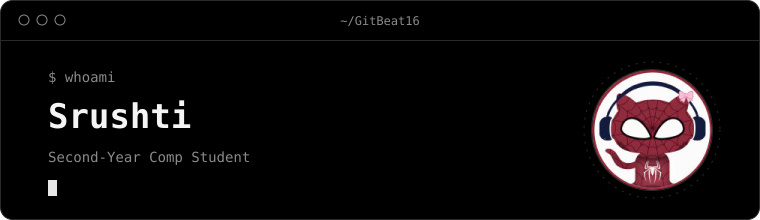

<picture>
  <source media="(prefers-color-scheme: dark)" srcset="readme/hero-dark.svg">
  <source media="(prefers-color-scheme: light)" srcset="readme/hero-light.svg">
  
</picture>

Generated by the GKins SVG spike. Check on: Mac, Windows, GitHub mobile app, light theme, dark theme.
