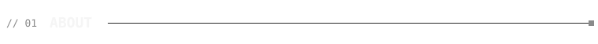
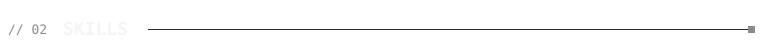
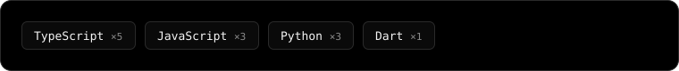
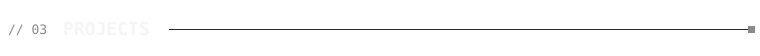
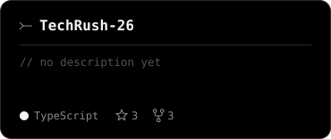
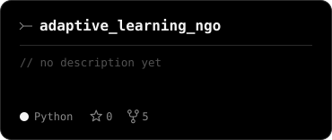
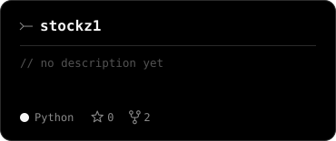
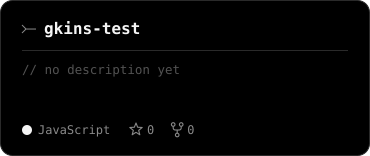

<!-- Made with GKins · theme: web-noir -->

<picture>
  <source media="(prefers-color-scheme: dark)" srcset="readme/hero-dark.svg">
  <source media="(prefers-color-scheme: light)" srcset="readme/hero-light.svg">
  
</picture>

<picture>
  <source media="(prefers-color-scheme: dark)" srcset="readme/title-about-dark.svg">
  <source media="(prefers-color-scheme: light)" srcset="readme/title-about-light.svg">
  
</picture>

Second-Year Comp Student

<picture>
  <source media="(prefers-color-scheme: dark)" srcset="readme/title-skills-dark.svg">
  <source media="(prefers-color-scheme: light)" srcset="readme/title-skills-light.svg">
  
</picture>

<picture>
  <source media="(prefers-color-scheme: dark)" srcset="readme/skills-dark.svg">
  <source media="(prefers-color-scheme: light)" srcset="readme/skills-light.svg">
  
</picture>

<picture>
  <source media="(prefers-color-scheme: dark)" srcset="readme/title-projects-dark.svg">
  <source media="(prefers-color-scheme: light)" srcset="readme/title-projects-light.svg">
  
</picture>

<a href="https://github.com/GitBeat16/TechRush-26"><picture><source media="(prefers-color-scheme: dark)" srcset="readme/repo-1-dark.svg"><source media="(prefers-color-scheme: light)" srcset="readme/repo-1-light.svg"></picture></a>
<a href="https://github.com/GitBeat16/adaptive_learning_ngo"><picture><source media="(prefers-color-scheme: dark)" srcset="readme/repo-2-dark.svg"><source media="(prefers-color-scheme: light)" srcset="readme/repo-2-light.svg"></picture></a>

<a href="https://github.com/GitBeat16/stockz1"><picture><source media="(prefers-color-scheme: dark)" srcset="readme/repo-3-dark.svg"><source media="(prefers-color-scheme: light)" srcset="readme/repo-3-light.svg"></picture></a>
<a href="https://github.com/GitBeat16/gkins-test"><picture><source media="(prefers-color-scheme: dark)" srcset="readme/repo-4-dark.svg"><source media="(prefers-color-scheme: light)" srcset="readme/repo-4-light.svg"></picture></a>

